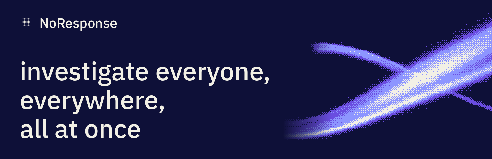

NoResponse finds the accounts behind an email address, phone number, username or name, and returns what they show about the person. Every profile, linked identifier, timestamp, location and image comes back typed, with the source it came from.

[Explore NoResponse](https://noresponse.org) · [Read the docs](https://docs.noresponse.org) · [Book a demo](https://noresponse.org/demo/)

## Build with NoResponse

Call the API from your own tools, case systems and pipelines. Choose your language to install a client and make your first call.

| SDK | Documentation |
| --- | --- |
| [TypeScript and Node.js](https://github.com/noresponsehq/node) | [Node.js guide](https://docs.noresponse.org/sdks/typescript) |
| [Python](https://github.com/noresponsehq/python) | [Python guide](https://docs.noresponse.org/sdks/python) |
| [Go](https://github.com/noresponsehq/go) | [Go guide](https://docs.noresponse.org/sdks/go) |
| [Java](https://github.com/noresponsehq/java) | [Java guide](https://docs.noresponse.org/sdks/java) |
| [.NET](https://github.com/noresponsehq/dotnet) | [.NET guide](https://docs.noresponse.org/sdks/csharp) |
| [PHP](https://github.com/noresponsehq/php) | [PHP guide](https://docs.noresponse.org/sdks/php) |
| [Ruby](https://github.com/noresponsehq/ruby) | [Ruby guide](https://docs.noresponse.org/sdks/ruby) |

For AI tools, use the [NoResponse MCP server](https://github.com/noresponsehq/mcp).

## Who it's for

Investigators in law enforcement, financial crime, threat intelligence, trust and safety and journalism. Each finding carries its source, so you can check it before you act on it.
