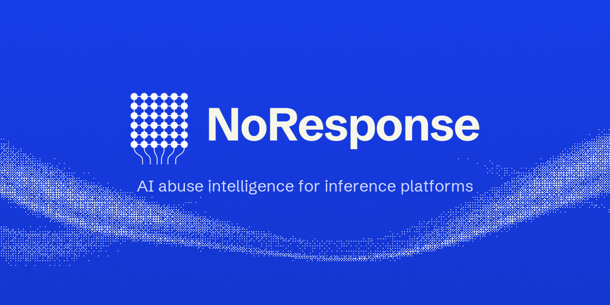

Find the abuse in your API. NoResponse connects the accounts behind the compute you're losing: sign-ups, repeat behaviour and suspected resale.

- Website: [noresponse.org](https://noresponse.org)
- Docs: [docs.noresponse.org](https://docs.noresponse.org)
- SDKs: [Node.js](https://github.com/noresponsehq/node), [Python](https://github.com/noresponsehq/python), [Go](https://github.com/noresponsehq/go), [Java](https://github.com/noresponsehq/java), [.NET](https://github.com/noresponsehq/dotnet), [PHP](https://github.com/noresponsehq/php), [Ruby](https://github.com/noresponsehq/ruby) and the [MCP server](https://github.com/noresponsehq/mcp)
